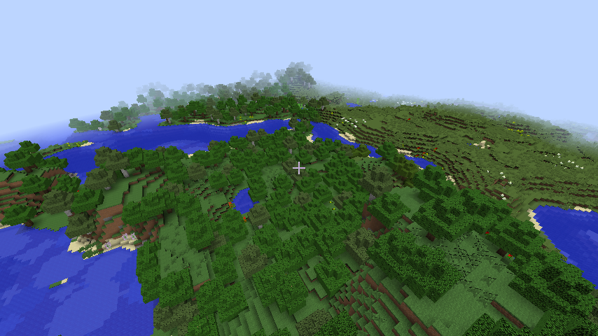
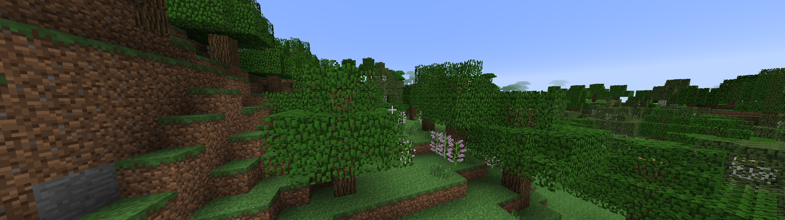

# MINERUST

Minecraft 1.7.10 的純 Rust 重寫，渲染使用 Vulkan。

以 MCP 反編譯的 1.7.10 原始碼為對照逐函式移植，並實際執行原版類別做逐位元組比對。
沒有任何 C/C++ 相依：Vulkan 走 `ash`，著色器以 WGSL 撰寫、啟動時用 `naga` 編成 SPIR‑V，不需要 Vulkan SDK。

材質不隨專案散布，執行時直接從原版 `1.7.10.jar` 讀取。




## 執行

```
cargo run --release -- --seed 1
```

| 參數 | 說明 |
| --- | --- |
| `--seed <數字或文字>` | 世界種子，規則同原版（文字取 `String.hashCode()`） |
| `--jar <路徑>` | 原版客戶端 jar；也可用環境變數 `MC1710_JAR`。預設找 `%APPDATA%\.minecraft\versions\1.7.10\1.7.10.jar` |
| `--world <資料夾>` | 存檔位置，預設 `saves/world`（指定種子時為 `saves/seed_<種子>`）。資料夾內有 `level.dat` 時視為原版 1.7.10 存檔，直接讀寫區域檔 |
| `--dim <-1\|0\|1>` | 起始維度：地獄、主世界、終界 |
| `--summon "Id:選項,..."` | 在玩家前方生成生物（距離由 `MINERUST_SUMMON_DIST` 指定） |
| `--export-anvil <來源> <目的>` | 把本專案的存檔轉成原版可開啟的 Anvil 世界 |
| `--no-save` | 不存檔 |
| `--distance <2..16>` | 視距（區塊），預設 12 |
| `--size <寬> <高>` | 視窗大小 |
| `--time <tick>` / `--freeze-time` | 起始世界時間 / 凍結時間 |
| `--pos x y z`、`--look yaw pitch` | 指定起始位置與視角（以飛行狀態開始） |
| `--vanilla-parity` | 關閉所有 bug 修正，行為與 1.7.10 完全相同 |
| `--validate` | 啟用 Vulkan validation layer（需已安裝） |
| `--screenshot <檔案> <秒>` | 載入完成後截圖並結束，不存檔 |
| 環境變數 `MINERUST_BENCH=<秒>` | 效能基準：載入完成後量測幀時間與伺服器 tick 並結束 |

操作：WASD 移動、空白鍵跳、左 Shift 潛行、左 Ctrl 或連按兩下 W 疾跑、連按兩下空白鍵切換飛行、
左鍵破壞、右鍵放置、中鍵選取方塊、F2 截圖、Esc 釋放滑鼠。

## 架構

- **伺服器執行緒**（`src/sim.rs`）：擁有世界，固定每秒 20 tick。區塊生成平行進行，但插入、裝飾、方塊更新的順序
  是固定的全序，不依賴時鐘、雜湊表順序或執行緒排程。同種子加同一串指令會得到同一個世界。
- **客戶端**（`src/game.rs`）：只持有伺服器送來的區塊快照，用來做玩家碰撞、選取與網格化；
  編輯以指令送回伺服器驗證後才生效。慢的一幀不會影響 tick，慢的 tick 不會卡住畫面。
- **網格化**（`src/render/mesher.rs`）：在工作執行緒上把 3×3 區塊快照轉成頂點，以 16×16×16 的渲染區塊
  （原版 `WorldRenderer`）為單位；方塊或光照變動只重建受影響的分段。
- **渲染**（`src/render/vk.rs`）：頂點是區塊內座標，原點以相機為基準，遠離原點不會抖動。區塊頂點放在顯存池，
  經暫存緩衝上傳，逐分段做視錐剔除。
- **存檔**（`src/world/save.rs`）：自有格式。每個檔案先寫暫存檔、`fsync`、再改名，
  帶版本號與 CRC‑32，檢查不過就視為不存在；未知欄位原樣保留。
- **Anvil**（`src/world/anvil.rs`）：NBT 讀寫、區域檔（`.mca`）、`level.dat`。原版存檔以這條路徑開啟，
  方塊、光照、高度圖、方塊實體、實體與排程更新原樣讀入並寫回。
- **維度**（`src/dimension.rs`）：每個維度各有一個世界，不在的維度暫停保存；傳送時整組切換。

## 已移植

- Java 語意：`java.util.Random`、`MathHelper`（含 sin 查表）、整數溢位與 float/double 混算、`HashMap` 迭代順序
- 地形：噪聲、整條 `GenLayer` 群系鏈、`ChunkProviderGenerate`、各群系地表、洞穴、峽谷
- 裝飾（`populate`）：水湖／岩漿湖、地牢（含真實戰利品與生怪磚）、全部礦脈、十三種樹、巨型蘑菇、花草、
  雙層植物、甘蔗、仙人掌、南瓜、西瓜、藤蔓、泉水、冰刺、沙漠井、積雪與結冰，以及各群系的裝飾覆寫
- 結構：村莊（全部房屋、農田、道路、水井、路燈、沙漠變體）、廢棄礦坑（含礦車箱子與洞穴蜘蛛生怪磚）、
  要塞（全部房間、圖書館、終界傳送門房）、沙漠神殿、叢林神殿（絆線、發射器、活塞、紅石線）、女巫小屋；
  `MapGenStructure` 的區塊登記順序、`HashMap` 迭代順序與 `data/*.dat` 狀態保存
- 戰利品：所有 `WeightedRandomChestContent` 表與附魔書（含附魔內容）
- 方塊：樓梯（含轉角形狀）、柵欄、玻璃板、鐵柵欄、門、梯子、鐵軌（`BlockRailBase$Rail` 形狀推導）、作物、
  耕地、羊毛、石磚、拉桿、按鈕、壓力板、中繼器、活塞、炼藥鍋、花盆、終界傳送門框架等的碰撞與繪製
- 光照：1.7.10 的增量光照引擎（含它對鄰近區塊是否已載入的依賴）
- 紅石：訊號強度與導線、紅石火把（含燒毀）、中繼器、拉桿、按鈕、壓力板、絆線、紅石燈、活塞與黏性活塞、
  TNT、音符盒、發射器、門與活板門
- 地獄：`ChunkProviderHell`（地形、岩漿海、螢石、火、蘑菇、地獄石英）、地獄要塞（全部構件與烈焰使者生怪磚），
  以 `PopHarness`（`DIM=-1`）逐格比對；地獄傳送門的點火、`Teleporter` 的搜尋與建造、傳送門冷卻
- 終界：`ChunkProviderEnd`（浮島、黑曜石柱、終界水晶）、終界傳送門啟動與進入、擊敗終界龍後的返回傳送門與龍蛋
- 火：`BlockFire` 的蔓延、燒毀、雨熄滅、永久燃燒的地獄岩與基岩；打火石點火
- 方塊更新：液體（地獄岩漿較快且會擴得更遠）、落沙與落礫、植物失去支撐、門與鐵軌與絆線鉤的鄰近更新、火把方向、熔爐與發射器朝向、
  隨機 tick（草與菌絲蔓延、樹葉腐爛、冰雪融化、仙人掌、甘蔗、蘑菇、藤蔓）
- 生物：豬、牛、羊（毛色與吃草）、雞（下蛋）、哞菇、殭屍、骷髏（射箭）、苦力怕（膨脹與爆炸，含方塊破壞）、
  蜘蛛與洞穴蜘蛛（撲擊、爬牆、中毒）、村民（職業、躲避殭屍）、女巫、蠹魚、
  史萊姆（分裂）、終界使者（瞬移、搬方塊）、魷魚、蝙蝠、狼（馴服、坐下、項圈）、豹貓（馴服成貓）、
  馬（種類與花色）、鐵魔像（村莊生成、守衛）；地獄與終界的地獄幽靈（火球）、殭屍豬人（群體仇恨）、
  烈焰使者（三連火球）、岩漿怪、凋零骷髏、終界龍（盤旋、俯衝、水晶治療、死亡動畫）。
  `PathFinder`、`EntityMoveHelper`、`EntityLookHelper`、`EntityBodyHelper`、日光燃燒、掉落物與經驗、
  世界生成時的動物（`performWorldGenSpawning`，用原版亂數決定位置）、夜間自然生成與遠距消失；模型逐一照
  `ModelQuadruped`／`ModelBiped`／`ModelVillager`／`ModelWitch` 等重建，含肢體擺動、頭部轉向、受傷變紅、死亡倒地
- 生存：挖掘時間、工具耐久、掉落與拾取、物品欄、合成、熔爐、箱子、生命、飢餓、氧氣、摔落與岩漿傷害、
  死亡與重生、經驗條與等級、攻擊生物（武器傷害、暴擊、疾跑擊退）
- `RenderBlocks`／`EntityRenderer`：方塊 AO、群系混色、液體、光照貼圖、天空與霧、日出日落、星星、雲、動態材質
- 聲音：純 Rust（cpal 輸出、lewton 解 Vorbis），經啟動器的資源索引與 sounds.json 解析事件；方塊破壞／放置／腳步、生物叫聲與受傷、弓、爆炸、玩家受傷、背景音樂（MusicTicker），含距離衰減與左右聲道
- 天氣：World.updateWeather 的降雨／雷雨週期（存檔保存），天空、霧、雲、太陽月亮與光照圖隨雨變暗，雨雪條紋（renderRainSnow，依群系溫度），寒冷群系積雪，雨聲；--weather rain|thunder|clear
- 粒子：方塊碎屑、煙、火焰、岩漿、滴水、雨滴濺起、爆炸、暴擊、疾跑揚塵、傳送門
- GUI：標題畫面與全部設定選單、語言、字型、HUD、背包、工作台、熔爐、釀造台、箱子、發射器、創造模式物品欄、聊天與指令、告示牌編輯、載入畫面、暫停與死亡畫面、F3、F5 第三人稱

## 尚未實作

完整清單與優先順序見 [docs/HANDOFF.md](docs/HANDOFF.md) 第 7 節與 [docs/PARITY_TODO.md](docs/PARITY_TODO.md)。
主要缺口：生物裝備與生物藥水效果、信標、漏斗、比較器、統計與成就、村民交易、騎馬、釣魚、多人連線。
（2026-11-14 補上：農業整套（耕地、種植、作物成長、骨粉、樹苗長成樹）、床與睡覺、蛋糕、柵欄門、圓石牆、南瓜／西瓜梗、
生物的盔甲與武器（骷髏拿弓、殭屍豬人拿金劍、隨機盔甲與附魔，與原版一致）。）

## 接手開發

接手的開發者或 AI 請先讀 [docs/HANDOFF.md](docs/HANDOFF.md)：目標、硬性準則、參考原始碼的取得方式、
架構、驗證與截圖方法、進度與開發日誌都在裡面，每次推送都會更新。

## 驗證

```
cargo test
```

- `java.util.Random` 的已知輸出
- 玩家物理的已知數值：步行 4.317 m/s、疾跑 5.612 m/s、跳躍頂點 1.2492 格、潛行不掉落、水流推力
- 決定性重播：同種子加同指令腳本，三次執行的世界狀態雜湊一致
- 存檔：原子寫入、損毀檔案拒收、存檔後重載方塊一致
- 紅石：拉桿→導線→紅石燈、火把反相、中繼器延遲、活塞推動、TNT 點燃與爆炸、壓力板開門
- 維度：地獄傳送門往返、終界傳送門進入、擊敗終界龍後返回；Anvil 世界的開啟、存檔、重開與匯出
- 生物 AI：殭屍追擊並命中、動物被食物吸引與受擊逃跑、骷髏射箭、殭屍豬人被打才還手、馴服的狼幫主人、鐵魔像打怪、
  餵食後繁殖出一隻幼體（原版任務系統 `EntityAITasks` 的移植）
- 方塊掉落：175 種方塊 × 16 中繼值 × 時運 0–3，掉落物、數量、經驗球與亂數順序和原版一致（`tools/DropHarness.java`）
- 附魔效果與生物掉落：保護各系列對每種傷害來源的數值、鋒利系列對三種生物屬性的加成、耐久與荊棘的亂數結果、
  33 種生物 × 掠奪 0–3 的死亡掉落與稀有掉落擲骰，和原版一致（`tools/EnchantFxHarness.java`）
- 方塊貼圖：每個已移植方塊的每個中繼值、每個面，與原版 `Block.getIcon` 的結果一致（`tools/IconHarness.java`）

與原版的逐位元組比對（需要反編譯的 1.7.10 jar 與其函式庫）：

```
# 地形階段
minerust --dump <seed> <區塊數> rust.bin
java -cp <classpath> Harness <seed> <區塊數> java.bin
minerust --compare rust.bin java.bin

# 裝飾階段（方塊、中繼值、天空光、方塊光）
minerust --dump-pop <seed> <cx> <cz> <半徑> rust.bin
java -cp <classpath> PopHarness <seed> <cx> <cz> <半徑> java.bin
minerust --compare-pop rust.bin java.bin <cx> <cz> <半徑>
```

結果：

- 地形階段：8 個種子 × 1000 區塊全部一致。
- 裝飾階段：3 個種子、每種群系各一區、共 136 區。方塊與中繼值全部一致；光照 133 區一致，
  3 個叢林區在巨樹樹冠附近有天空光差異，原因未查出。
- 結構（`mapFeatures` 開啟）：10 個種子、50 多個結構（村莊、礦坑、要塞、三種神殿）逐方塊比對。
  方塊、中繼值、方塊光全部一致；天空光只有 1 座沙漠神殿塔內的一小塊封閉空間不同（原因未查出）。

- 地獄（`DIM=-1`）：地形與要塞逐方塊一致；少數邊緣岩漿穴與岩漿海方塊光不同，來自原版裝飾順序依載入時機而定。
- Anvil：`tools/AnvilHarness.java` 以原版 `AnvilChunkLoader` 讀本專案寫出的區域檔、本專案讀原版寫出的區域檔，
  方塊、中繼值、天空光、方塊光、高度圖雙向一致。

效能（`MINERUST_BENCH=10`，RTX 5070 Laptop、1920×1080、不限幀）：視距 12 約 1,575 fps、視距 16 約 1,311 fps，
視距 16 的世界 7 秒載完，伺服器 tick 平均 5 ms。量測方法與歷次數字見 [docs/HANDOFF.md](docs/HANDOFF.md) 第 5.3 節。
預設與原版相同：垂直同步開、最大幀率 120，可在影像設定調整。

沒有驗證的部分：鍵盤滑鼠操作是否順手、長時間執行的記憶體用量、Vulkan validation layer（本機未安裝）。

原版 bug 的逐項處理見 [docs/BUG_AUDIT.md](docs/BUG_AUDIT.md)。
